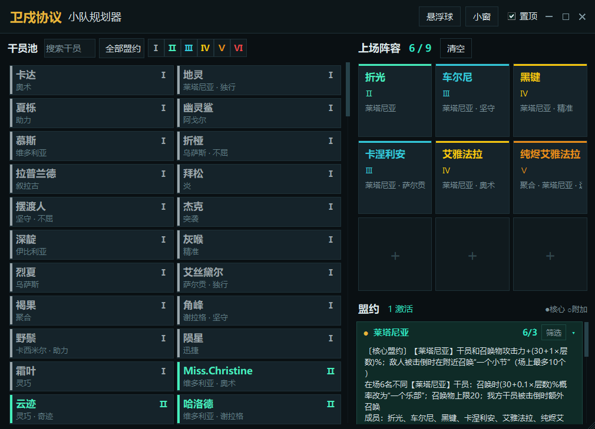

# 卫戍协议小队规划器

一个仿《云顶之弈》交互方式的《明日方舟》卫戍协议阵容规划工具，Windows 桌面端，纯 Python + tkinter，无第三方依赖。

## 功能

- 143 名干员、25 个盟约的阵容规划，最多 9 人上场
- 实时统计盟约人数与激活状态，核心 / 附加盟约说明可展开
- 按名称 / 盟约搜索，按等级、盟约一键筛选
- 窗口置顶、小窗模式、半透明悬浮球（自动跟随窗口所在角落）
- 干员池列数随窗口宽度自适应，窗口大小自动记忆
- 深色界面，支持高 DPI

## 下载与运行

- **安装包**：见 [Releases](../../releases)，带卸载程序，安装到当前用户目录，无需管理员权限
- **源码运行**：安装 Python 3.10+ 后双击 `启动.bat`，或执行 `python app.py`

## 数据说明

`data.json` 由 PRTS Wiki 与游戏公开数据表整理，包含干员名称、等级、所属盟约及盟约说明。数据版权归原权利方所有。

## 免责声明

非官方同人工具，与鹰角网络无关，仅供学习与个人非商业使用。

## License

[MIT](LICENSE)
